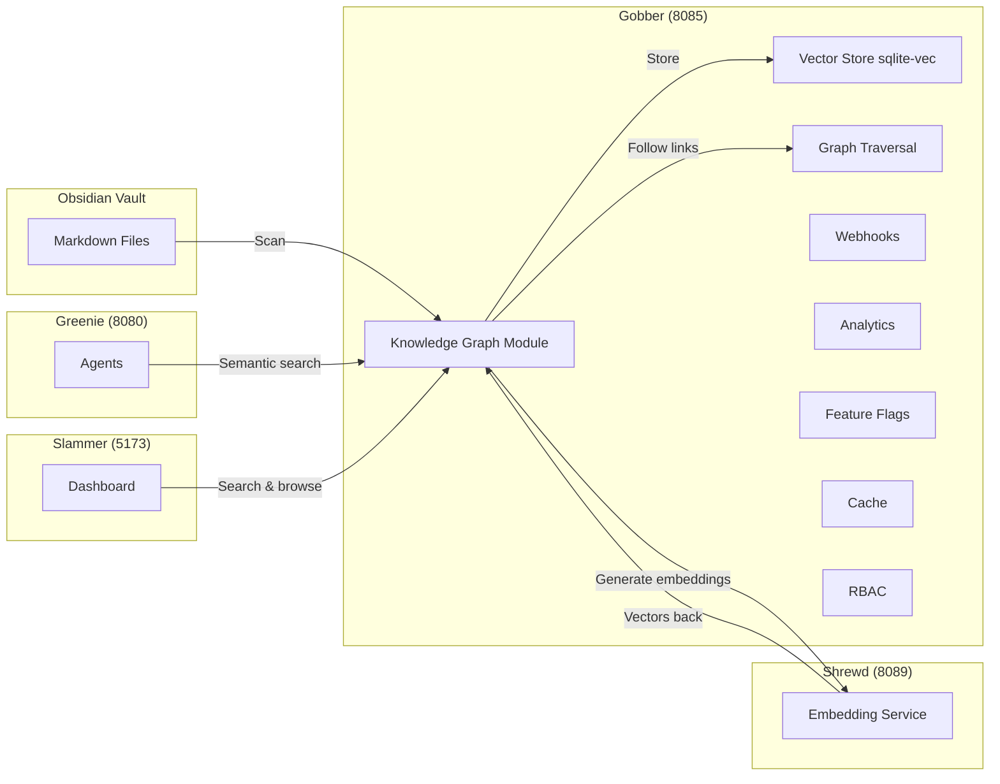

# Requirements

### Overview
Integrate **Obsidian vault as a second brain** into **Gobber** (persistent storage service), combining it with a **knowledge graph / semantic memory** layer. This enables agents to read your Obsidian notes, generate embeddings, and perform semantic search — finding relevant information by meaning rather than keywords.

### What is "Obsidian as a second brain"?
An Obsidian vault is a collection of Markdown files with internal links (e.g., `[[Note Name]]`). A "second brain" system:
1. **Scans** your vault directory for `.md` files
2. **Parses** note content and extracts links between notes
3. **Generates embeddings** (vector representations) for each note using an LLM (Ollama, OpenAI, etc.)
4. **Stores** embeddings in a vector database (sqlite-vec)
5. **Searches** semantically — given a query, finds the most relevant notes by meaning
6. **Traverses** the graph of links to find related context

### Why integrate into Gobber?
Gobber is already the persistent storage service with SQLite. Adding a knowledge graph module extends its role from operational storage (webhooks, analytics, RBAC) to **semantic memory** — making it the brain of the Evershade ecosystem.

### Key Features
- **Vault scanning**: Read `.md` files from a configurable Obsidian vault directory
- **Embedding generation**: Use Shrewd (LLM abstraction) or Ollama to generate vector embeddings
- **Semantic search**: Query notes by meaning, get ranked results with relevance scores
- **Graph traversal**: Follow `[[links]]` between notes to discover related context
- **Auto-indexing**: Re-index when notes change (file watch or manual trigger)
- **API endpoints**: REST API for indexing, searching, and managing the knowledge graph

### Architecture Diagram



### Scope
- **In Scope**: Knowledge graph module in Gobber, Obsidian vault integration, semantic search API, vector storage, graph traversal
- **Out of Scope**: Modifying Obsidian itself, mobile support, real-time sync with Obsidian desktop app

# Technical Design

### Current Implementation
**Gobber** currently has:
- `gobber/api.py` — FastAPI app with endpoints for webhooks, analytics, feature flags, cache, RBAC
- `gobber/models.py` — Data models (Webhook, AnalyticsEvent, FeatureFlag, CacheEntry, Role, UserRole)
- `gobber/storage.py` — SQLite backend with tables for all the above
- SQLite database at `/app/data/gobber.db`

### Proposed Changes
Add a new **knowledge graph module** to Gobber:

1. **New files**:
   - `gobber/knowledge_graph.py` — Core logic: vault scanning, embedding generation, semantic search, graph traversal
   - `gobber/kg_models.py` — Models: Note, NoteLink, Embedding, SearchResult
   - `gobber/kg_storage.py` — SQLite tables for notes, embeddings, and graph relationships

2. **New API endpoints** in `gobber/api.py`:
   - `POST /api/vault/index` — Index or re-index the Obsidian vault
   - `GET /api/vault/notes` — List all indexed notes
   - `GET /api/vault/notes/{note_id}` — Get a specific note
   - `POST /api/vault/search` — Semantic search (query string, returns ranked notes)
   - `GET /api/vault/notes/{note_id}/links` — Get links from a note (graph traversal)
   - `GET /api/vault/notes/{note_id}/related` — Get semantically related notes
   - `DELETE /api/vault/notes/{note_id}` — Remove a note from the index
   - `GET /api/vault/stats` — Statistics (total notes, links, last indexed)

3. **New SQLite tables**:
   - `notes` — note_id, file_path, title, content, created_at, updated_at
   - `note_links` — source_note_id, target_note_id (for [[links]])
   - `note_embeddings` — note_id, embedding (vector blob via sqlite-vec)

4. **Dependencies**:
   - `sqlite-vec` — Vector storage extension for SQLite
   - `shrewd` (internal) — Use Shrewd service for embedding generation, or fallback to Ollama directly
   - File watching (optional) — Auto-reindex on file changes

### Key Decisions
- **sqlite-vec** for vector storage — keeps everything in SQLite, no new database needed
- **Shrewd for embeddings** — reuses the LLM abstraction service instead of hardcoding Ollama
- **File-based vault scanning** — reads `.md` files directly, no Obsidian API needed
- **Lazy indexing** — index on demand or via cron, not real-time (simpler, less overhead)

### Data Models
```python
class Note:
    id: UUID
    file_path: str          # Relative path in vault
    title: str              # Extracted from frontmatter or filename
    content: str            # Markdown content
    links: list[str]        # [[linked notes]]
    created_at: datetime
    updated_at: datetime

class SearchResult:
    note: Note
    score: float            # Cosine similarity (0-1)
    context: str            # Relevant excerpt
```

# Delivery Steps

### ✓ Step 1: Add knowledge graph models and storage to Gobber
Create the data models and SQLite storage layer for the knowledge graph module.
- Add `gobber/kg_models.py` with Note, NoteLink, Embedding, and SearchResult models
- Add `gobber/kg_storage.py` with SQLite tables (notes, note_links, note_embeddings) and sqlite-vec integration
- Add new tables to `gobber/storage.py` initialization
- Update `Gobber/pyproject.toml` to include `sqlite-vec` dependency

### ✓ Step 2: Implement vault scanning and embedding generation
Implement the core knowledge graph logic in `gobber/knowledge_graph.py`.
- Vault scanner: read `.md` files, parse frontmatter, extract `[[links]]`
- Embedding generator: call Shrewd service (or Ollama fallback) to generate vectors
- Index manager: store notes, links, and embeddings in SQLite
- Graph traversal: BFS/DFS through note links to find related context
- Auto-indexing support (manual trigger + optional file watch)

### ✓ Step 3: Add semantic search API endpoints to Gobber
Add REST API endpoints for the knowledge graph in `gobber/api.py`.
- `POST /api/vault/index` — trigger vault indexing
- `GET /api/vault/notes` — list all indexed notes
- `POST /api/vault/search` — semantic search with cosine similarity ranking
- `GET /api/vault/notes/{id}/links` — get graph links from a note
- `GET /api/vault/notes/{id}/related` — get semantically related notes
- `GET /api/vault/stats` — indexing statistics
- Update `Gobber/README.md` with documentation

### ✓ Step 4: Update architecture, tests, and documentation
Finalize integration with tests, Docker config, and updated documentation.
- Add tests in `Gobber/tests/test_knowledge_graph.py` for vault scanning, embeddings, and search
- Update `docker-compose.yml` to mount Obsidian vault directory into Gobber container
- Update root `README.md` with an architecture diagram showing all 10 services and how they connect
- Update `start.ps1`/`start.sh` to mention Obsidian vault configuration