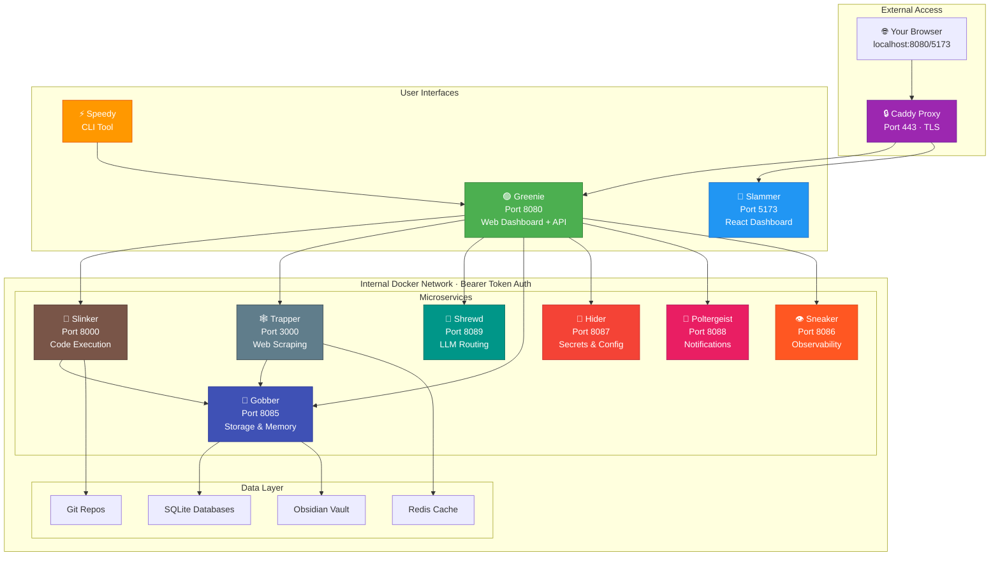
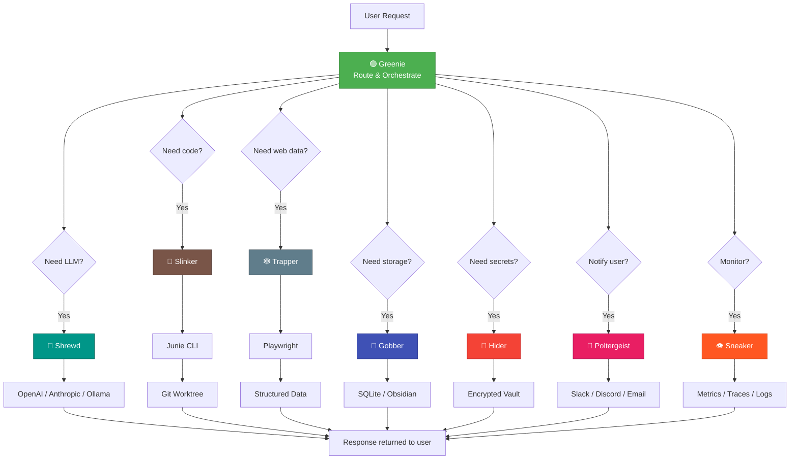
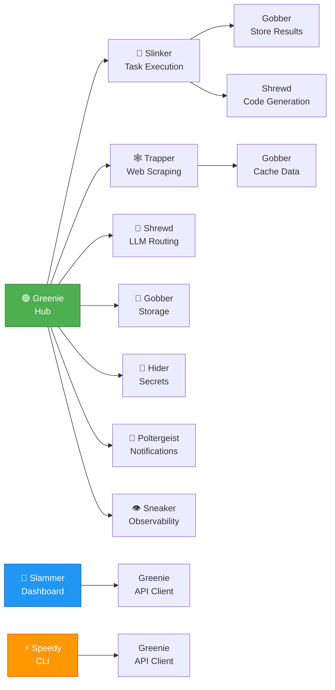

# Evershade

> *"E. Gadd to Luigi! Am I comin' in clear, do you read me?"*
> ~ **Prof. E. Gadd**, Luigi's Mansion: Dark Moon

**A self-hosted AI agent platform built as a collection of specialized microservices.**

[](LICENSE)
[](https://docker.com)

---

## Table of Contents

- [Quick Start](#quick-start) — Get up and running in 3 minutes
- [Your First Agent](#your-first-agent) — Step-by-step tutorial
- [Architecture](#architecture) — How everything fits together
- [Services](#services) — The 10 microservices at a glance
- [Web Interfaces](#web-interfaces) — Dashboards and UIs
- [API Documentation](#api-documentation) — Developer endpoints
- [Configuration](#configuration) — Environment variables and settings
- [Deployment](#deployment) — Production and remote access
- [Security](#security) — Security model and best practices
- [Testing](#testing) — Test suite and quality gates
- [Contributing](#contributing) — How to help
- [Naming Theme](#naming-theme) — The Luigi's Mansion connection
- [License](#license)

---

## Quick Start

> *"Step into the dark! Five new spooky mansions!"*
> ~ **The Dark Moon Song**, on the adventure ahead

### Prerequisites

- **Docker** and **Docker Compose** installed
- **[Junie CLI](https://junie.jetbrains.com)** (optional, for code agents)

### One-Command Start

```bash
git clone https://github.com/LukaG712/Evershade.git && cd Evershade
cp .env.example .env
# Edit .env with your API keys (see [Configuration](#configuration))
docker compose --profile minimal up -d
```

The dashboard will be available at **http://localhost:8080**.

### Installation Profiles

| Profile | Services | Command |
|---------|----------|---------|
| **Minimal** | Core only | `docker compose --profile minimal up -d` |
| **Standard** | All services | `docker compose --profile standard up -d` |
| **Full** | + Dashboard | `docker compose --profile full up -d` |
| **+ Ollama** | Local LLM | `docker compose --profile standard --profile ollama up -d` |

### Startup Scripts

```bash
# Linux/macOS
./start.sh    # Start all services
./stop.sh     # Stop all services

# Windows PowerShell
.\start.ps1   # Start all services
.\stop.ps1    # Stop all services
```

---

## Your First Agent

This tutorial walks you through setting up Evershade and running your first AI agent.

### Step 1: Install and Start

```bash
git clone https://github.com/LukaG712/Evershade.git && cd Evershade
cp .env.example .env
# Edit .env — at minimum, set unique API keys
docker compose --profile minimal up -d
```

### Step 2: Access the Dashboard

Open **http://localhost:8080** in your browser. You'll see the Greenie dashboard with:

- **Chat** — Talk to AI agents
- **Dashboard** — Manage agents, runs, pipelines
- **API Docs** — Swagger UI at `/docs`

### Step 3: Create Your First Agent

1. Go to **Dashboard → Agents**
2. Click **Create Agent**
3. Fill in:
   - **Name**: `researcher`
   - **Runner**: `junie`
   - **Guidelines**: `Always cite your sources.`
4. Click **Save**

### Step 4: Run a Task

1. Go to **Chat**
2. Select your `researcher` agent
3. Type: `Summarize the key points of climate change`
4. Watch the agent work in real-time

### Step 5: Try a Pipeline

Create a cross-service pipeline via the API:

```bash
curl -X POST http://localhost:8080/api/pipeline \
  -H "Authorization: Bearer $EVERSHADE_GREENIE_API_KEY" \
  -H "Content-Type: application/json" \
  -d '{
    "steps": [
      { "service": "Trapper", "action": "scrape", "url": "https://news.ycombinator.com" },
      { "service": "Greenie", "action": "chat", "agent": "researcher", "prompt": "Summarize the top 5 stories" }
    ]
  }'
```

### Step 6: Explore More

- **Workflows** — Automate recurring tasks with schedules and triggers
- **Slammer Dashboard** — Standalone dashboard at `http://localhost:5173`
- **Speedy CLI** — Manage everything from the terminal: `evershade agents list`
- **Notifications** — Configure Slack/Discord alerts via Poltergeist
- **LLM Providers** — Connect OpenAI, Anthropic, or Ollama via Shrewd

---

## Architecture

### System Overview



### Data Flow Diagram



### Service Dependencies



### How They Work Together

1. **You** interact with Greenie's web dashboard at `localhost:8080` or Slammer at `localhost:5173`
2. **Greenie** manages your agents, sessions, pipelines, workflows, and workstations
3. When a task needs code execution, Greenie sends it to **Slinker**
4. When a task needs web data, Greenie sends it to **Trapper**
5. **Shrewd** routes LLM requests to OpenAI, Anthropic, Google, or Ollama
6. **Hider** stores secrets encrypted at rest (AES-256-GCM)
7. **Gobber** provides persistent storage, cache, and knowledge graph
8. **Poltergeist** sends notifications to Slack, Discord, email, Telegram
9. **Sneaker** collects metrics and traces for observability
10. Results flow back through Greenie to your dashboard

### Cross-Service Pipelines

Chain services together in a single request:

```json
POST /api/pipeline
{
  "steps": [
    { "service": "Trapper", "action": "scrape", "url": "https://example.com" },
    { "service": "Greenie", "action": "chat", "agent": "researcher" },
    { "service": "Slinker", "action": "execute", "prompt": "Create a summary document" }
  ]
}
```

### Workflow Engine

Automate multi-step workflows with triggers, approvals, and conditions:

```json
POST /api/workflows
{
  "name": "Research Pipeline",
  "trigger": { "type": "schedule", "cron": "0 9 * * 1" },
  "steps": [
    { "type": "service", "service": "Trapper", "action": "scrape", "url": "https://news.example.com" },
    { "type": "agent", "agent": "researcher", "prompt": "Summarize the latest news" },
    { "type": "approval", "message": "Review the summary before sending" },
    { "type": "notify", "channel": "slack", "recipient": "#research" }
  ]
}
```

---

## Services

> *"The Dark Moon has shattered, Luigi! We need to find it and restore peace to Evershade Valley, posthaste!"*
> ~ **Prof. E. Gadd**, on the state of the valley

All service names are inspired by [Luigi's Mansion ghosts](https://luigi-mansion.fandom.com/wiki/List_of_ghosts). See the [Naming Theme](#naming-theme) section for details.

### Service Overview

| Service | Port | Role | UI |
|---------|------|------|-----|
| **Greenie** | `8080` | Central hub & orchestrator | Web dashboard + API |
| **Slinker** | `8000` | Task execution engine | API only |
| **Trapper** | `3000` | Web scraping & crawling | API only |
| **Gobber** | `8085` | Persistent storage & knowledge graph | API only |
| **Sneaker** | `8086` | Observability (metrics, traces, logs) | API only |
| **Hider** | `8087` | Secrets & config management | API only |
| **Poltergeist** | `8088` | Notifications (Slack, Discord, email, Telegram) | API only |
| **Shrewd** | `8089` | LLM provider abstraction | API only |
| **Slammer** | `5173` | Standalone web dashboard | React web app |
| **Speedy** | — | CLI tool (`evershade` command) | Terminal |

### Service Details

#### Greenie — Central Hub & Dashboard

The brain of the operation. Greenie is a full-featured API server with a built-in web dashboard. It manages AI agents, chat sessions, pipelines, analytics, and provides a unified view of the entire platform.

- **320+ API endpoints** with Swagger/ReDoc docs
- **SQLite** with feature-store persistence
- Greenie is the only service with a web frontend; everything you interact with visually runs through Greenie

**Repo:** [LukaG712/Greenie](https://github.com/LukaG712/Greenie)

---

#### Slinker — Execution Engine

The worker behind the scenes. Slinker takes tasks from Greenie and executes them in isolated Git worktrees using the Junie CLI. It handles code generation, file modifications, refactoring, and any task that requires running AI agents against a codebase.

- **Git worktrees** per task for isolation
- **Junie CLI** integration for code agents
- Pure API service — manage tasks through Greenie's dashboard

**Repo:** [LukaG712/Slinker](https://github.com/LukaG712/Slinker)

---

#### Trapper — Web Scraping & Crawling

The eyes on the web. Trapper uses Playwright to scrape, crawl, search, and map websites, turning raw HTML into clean, structured, LLM-ready data.

- **Playwright headless** browser automation
- **Redis-backed** job queue for background tasks
- Single-page scraping, deep crawling, and site mapping

**Repo:** [LukaG712/Trapper](https://github.com/LukaG712/Trapper)

---

#### Gobber — Persistent Storage & Knowledge Graph

The memory and brain of the ecosystem. Gobber provides persistent storage for webhooks, analytics, RBAC, cache, and feature flags — solving the in-memory data loss problem when services restart.

- **SQLite with WAL mode** for durability
- **Obsidian vault integration** — scan notes, generate embeddings, enable semantic search
- Centralized data layer and semantic memory

**Repo:** [LukaG712/Gobber](https://github.com/LukaG712/Gobber)

---

#### Sneaker — Observability

The eyes on your system. Sneaker collects metrics, traces, and logs from all services, providing unified observability.

- **Metrics**, distributed traces, and log aggregation
- System health monitoring across all services

**Repo:** [LukaG712/Sneaker](https://github.com/LukaG712/Sneaker)

---

#### Hider — Secrets & Config

The vault for sensitive data. Hider provides encrypted storage for API keys, passwords, and centralized configuration management.

- **AES-256-GCM** encryption for secrets at rest
- Versioned configuration management

**Repo:** [LukaG712/Hider](https://github.com/LukaG712/Hider)

---

#### Poltergeist — Notifications

The messenger of the ecosystem. Poltergeist sends notifications to Slack, Discord, email, and Telegram with templated messages and async delivery.

- **Channels:** Slack, Discord, email, Telegram, webhooks
- Unified notification hub

**Repo:** [LukaG712/Poltergeist](https://github.com/LukaG712/Poltergeist)

---

#### Shrewd — LLM Abstraction

The brain behind the models. Shrewd provides a unified interface for OpenAI, Anthropic, Google, and Ollama — letting you swap models and manage costs.

- **Providers:** OpenAI, Anthropic, Google, Ollama
- LLM provider abstraction layer

**Repo:** [LukaG712/Shrewd](https://github.com/LukaG712/Shrewd)

---

#### Slammer — Web Dashboard

The command center. Slammer is a React-based standalone web dashboard for managing agents, runs, pipelines, and analytics across all Evershade services.

- **Stack:** React, TypeScript, Tailwind CSS
- Standalone alternative to Greenie's built-in dashboard

**Repo:** [LukaG712/Slammer](https://github.com/LukaG712/Slammer)

---

#### Speedy — CLI Tool

The terminal companion. Speedy provides an `evershade` command for managing services, agents, tasks, and configuration from the command line.

- **Install:** `pip install speedy-cli`
- **Command:** `evershade`

**Repo:** [LukaG712/Speedy](https://github.com/LukaG712/Speedy)

---

## Web Interfaces

All visual interfaces are served by Greenie:

| Interface | URL | Description |
|-----------|-----|-------------|
| **Chat UI** | `http://localhost:8080/` | Agent chat, skills, memory, routines |
| **Dashboard** | `http://localhost:8080/dashboard/` | Agents, runs, pipelines, analytics, settings |
| **Tasks App** | `http://localhost:8080/app/` | Simple task list |
| **API Docs** | `http://localhost:8080/docs` | Swagger UI for all endpoints |

> **Note:** Slinker and Trapper are API-only services with no web frontend. All management happens through Greenie's dashboard.

---

## API Documentation

Each service exposes auto-generated API docs:

| Service | Swagger UI | ReDoc | OpenAPI JSON |
|---------|-----------|-------|-------------|
| **Greenie** | `localhost:8080/docs` | `localhost:8080/redoc` | `localhost:8080/openapi.json` |
| **Slinker** | `localhost:8000/docs` | `localhost:8000/redoc` | `localhost:8000/openapi.json` |
| **Trapper** | `localhost:3000/docs` | `localhost:3000/redoc` | `localhost:3000/openapi.json` |

---

## Configuration

Copy `.env.example` to `.env` and configure. See [docs/CONFIGURATION.md](docs/CONFIGURATION.md) for the full reference.

### API Keys (Required)

Generate unique keys for each service. **Never use the default values in production.**

```bash
# Generate a secure key
openssl rand -hex 32
```

All variables use the `EVERSHADE_<SERVICE>_<SETTING>` naming convention. Legacy names (e.g., `HUB_API_KEY`) still work but are deprecated.

| Variable | Description |
|----------|-------------|
| `EVERSHADE_GREENIE_API_KEY` | Greenie API key |
| `EVERSHADE_SLINKER_API_KEY` | Slinker API key |
| `EVERSHADE_TRAPPER_API_KEY` | Trapper API key |
| `EVERSHADE_GOBBER_API_KEY` | Gobber API key |
| `EVERSHADE_ENCRYPTION_KEY` | Hider encryption key |

### Optional Configuration

| Variable | Default | Description |
|----------|---------|-------------|
| `EVERSHADE_OPENAI_API_KEY` | *(empty)* | OpenAI API key |
| `EVERSHADE_OLLAMA_URL` | `http://host.docker.internal:11434` | Ollama endpoint |
| `EVERSHADE_OLLAMA_MODEL` | `gemma4:12b` | Default Ollama model |
| `EVERSHADE_WORKSPACE_PATH` | `./workspace` | Workspace directory |
| `EVERSHADE_MAX_CONCURRENT_WORKERS` | `1` | Concurrent Slinker workers |
| `EVERSHADE_ISOLATION_MODE` | `worktree` | Isolation mode |
| `EVERSHADE_OBSIDIAN_VAULT_PATH` | `./obsidian-vault` | Obsidian vault path |
| `EVERSHADE_LOG_LEVEL` | `INFO` | Log verbosity |

### Deployment Mode

| Variable | Default | Description |
|----------|---------|-------------|
| `EVERSHADE_MODE` | `desktop` | `desktop` = loopback, `server` = all interfaces |
| `EVERSHADE_BIND_ADDRESS` | `127.0.0.1` | Bind address for host ports |
| `EVERSHADE_PUBLIC_URL` | `http://localhost:8080` | Public base URL |

---

## Deployment

For server deployment (headless VM, access from another computer), see [docs/DEPLOYMENT.md](docs/DEPLOYMENT.md).

```bash
# Server mode: edit .env
EVERSHADE_MODE=server
EVERSHADE_BIND_ADDRESS=0.0.0.0
EVERSHADE_PUBLIC_URL=http://YOUR_SERVER_IP:8080
```

---

## Security

- **Bearer token auth** on all services (query params rejected)
- **AES-256-GCM encryption** for secrets at rest (Hider)
- **SSRF protection** blocks private IPs and cloud metadata (Trapper)
- **Read-only containers** with capability dropping
- **Internal Docker network** — only Greenie exposed on host

### Security Notes

- Server mode refuses to start with default API keys
- Resource limits are applied to all services
- Store your `.env` file securely and never commit it to version control
- See [docs/SECURITY.md](docs/SECURITY.md) for the full security model

---

## Testing

Evershade includes a comprehensive test suite covering integration, security, performance, and reliability. See [docs/TESTING.md](docs/TESTING.md) for details.

| Category | Description | Command |
|----------|-------------|---------|
| **Unit** | Tests without live services | `./tests/run-all-tests.sh unit` |
| **Integration** | Cross-service communication | `./tests/run-all-tests.sh integration` |
| **Security** | Prompt injection, SSRF, auth bypass | `./tests/run-all-tests.sh security` |
| **Benchmarks** | Latency, throughput, concurrency | `./tests/run-all-tests.sh benchmarks` |
| **Evaluation** | Agent quality scoring | `./tests/run-all-tests.sh evaluation` |
| **Chaos** | Failure injection, resilience | `./tests/run-all-tests.sh chaos` |
| **All** | Run everything (requires services) | `./tests/run-all-tests.sh all` |

### Running Tests

```bash
# Run unit tests (no services required)
./tests/run-all-tests.sh unit

# Start all services first (for integration tests)
docker compose --profile standard up -d

# Run all tests (requires services)
./tests/run-all-tests.sh all

# Run a specific category
./tests/run-all-tests.sh security
```

### Release Signing

```bash
# Sign all artifacts for a release
python scripts/release_sign.py --version 1.5.0 --sign-all --secret "your-signing-key"

# Verify a release
python scripts/verify_release.py --release release/ --secret "your-signing-key"
```

---

## Contributing

We welcome contributions! Please see [CONTRIBUTING.md](CONTRIBUTING.md) for guidelines on reporting bugs, suggesting features, and submitting pull requests.

```bash
# Quick development setup
git clone https://github.com/LukaG712/Evershade.git
cd Evershade
cp .env.example .env
docker compose --profile dev up -d
```

For detailed development instructions, see [docs/DEVELOPMENT.md](docs/DEVELOPMENT.md).

---

## Repository Structure

```
Evershade/ (this repo — orchestration)
├── .github/workflows/ci.yml   ← Root CI pipeline
├── docker-compose.yml         ← Service orchestration
├── start.sh / stop.sh         ← Startup scripts
├── start.ps1 / stop.ps1       ← Windows scripts
├── Greenie/                   → Separate repo (LukaG712/Greenie)
├── Slinker/                   → Separate repo (LukaG712/Slinker)
├── Trapper/                   → Separate repo (LukaG712/Trapper)
├── Gobber/                    → Separate repo (LukaG712/Gobber)
├── Sneaker/                   → Separate repo (LukaG712/Sneaker)
├── Hider/                     → Separate repo (LukaG712/Hider)
├── Poltergeist/               → Separate repo (LukaG712/Poltergeist)
├── Shrewd/                    → Separate repo (LukaG712/Shrewd)
├── Slammer/                   → Separate repo (LukaG712/Slammer)
└── Speedy/                    → Separate repo (LukaG712/Speedy)
```

Each sub-project is an independent Git repository with its own CI pipeline. The root repo tracks orchestration files (Docker Compose, CI, scripts) and excludes the sub-project directories via `.gitignore`.

---

## Future Expansion

The ecosystem is designed to grow. Planned service decisions after audit:

| Service | Role | Decision | Rationale |
|---------|------|----------|-----------|
| **Mnemos** | Semantic memory | **DROP** | Gobber already covers this. Extend Gobber instead. |
| **Bridge** | External integrations | **EVALUATE** | Greenie has webhooks. Only if new types needed. |
| **Courier** | File storage | **EVALUATE** | Greenie has 50MB upload. Only if more needed. |

See [docs/ARCHITECTURE.md](docs/ARCHITECTURE.md) and [ROADMAP.md](ROADMAP.md) for details.

---

## Naming Theme

> *"Everything was swell, until someone split the Dark Moon..."*
> ~ **The Dark Moon Song**, on how it all began

All services are named after ghosts from the **Luigi's Mansion** series. The root repository is named **Evershade** after *Evershade Valley*, the setting of Luigi's Mansion: Dark Moon.

| Service | Ghost Origin | Game |
|---------|-------------|------|
| **Greenie** | Small green ghosts | Luigi's Mansion: Dark Moon |
| **Slinker** | Wall-crawling stealth ghosts | Luigi's Mansion 3 |
| **Trapper** | Trap-setting ghosts | Luigi's Mansion 3 |
| **Gobber** | Blob-like absorbing ghost | Luigi's Mansion: Dark Moon |
| **Sneaker** | Quiet sneaking ghost | Luigi's Mansion: Dark Moon |
| **Hider** | Hiding ghost | Luigi's Mansion: Dark Moon |
| **Poltergeist** | Ancient disturbance ghost | Luigi's Mansion: Dark Moon |
| **Shrewd** | Possessor (Three Sisters) | Luigi's Mansion: Dark Moon |
| **Slammer** | Heavy-hitting ground slammer | Luigi's Mansion: Dark Moon |
| **Speedy** | Fast zooming ghost | Luigi's Mansion: Dark Moon |

### Future Service Name Ideas

More ghost names from the series available for new services:

| Name | Origin | Suggested Role |
|------|--------|---------------|
| **Boo** | Classic iconic ghost | Authentication / gateway service |
| **Oozers** | LM3 ooze-like ghosts | File storage / blob service |
| **Hammer** | LM3 hammer-wielding ghost | Deployment / infrastructure service |
| **Goob** | LM3 basic ghost | Task queue / job scheduler |
| **Grouchy** | Dark Moon spider boss | Security / firewall service |
| **Nana** | Dark Moon portrait ghost | Document processing service |
| **Shivers** | Dark Moon ice ghost | Cooling / rate limiting service |
| **Biff** | Dark Moon bouncer ghost | API gateway / load balancer |

---

## License

This project is licensed under the [MIT License](LICENSE).

| Repository | License |
|------------|---------|
| Evershade (root) | MIT |
| Greenie | MIT (see [Greenie/LICENSE](Greenie/LICENSE)) |
| Slinker | MIT |
| Trapper | MIT (see [Trapper/LICENSE](Trapper/LICENSE)) |
| Other services | MIT |

---

> *"Now that all the ghosts of Evershade Valley are under my control..."*
> ~ **King Boo**, Luigi's Mansion: Dark Moon

> *"Oh boy..."*
> ~ **Luigi**, probably

---

> **Disclaimer:** This project is a fan-made, independent software project. It is not affiliated with, endorsed by, or in any way connected to Nintendo, Next Level Games, or any of their subsidiaries. All Luigi's Mansion trademarks and character names are property of their respective owners. Service names are used purely for thematic inspiration.
